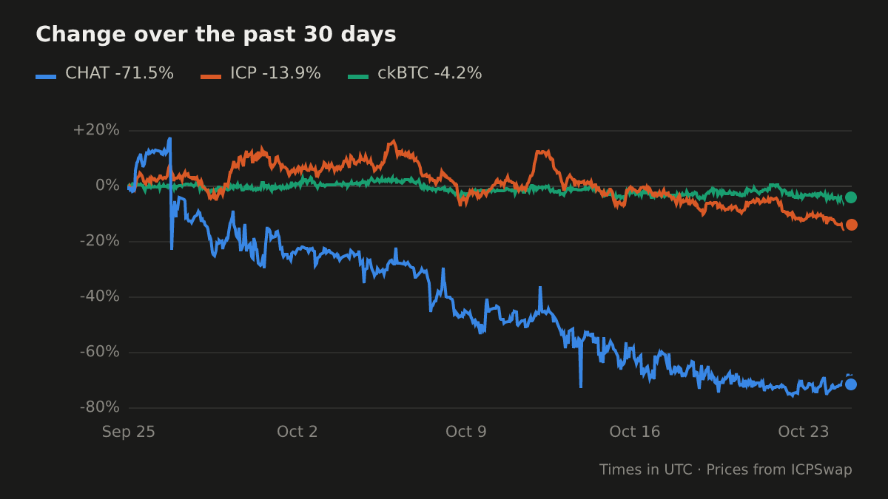

# ChartBot

Replies to `/chart` with a price chart of one or more crypto tokens:

- `/chart CHAT` charts CHAT's price in USD over the last 7 days.
- `/chart CHAT ICP ckBTC 30d` charts how each changed over the last 30 days, as a percentage of its
  price at the start, so they share an axis.

The period is optional and goes anywhere: `1d`, `7d` (the default), `30d`, `90d` or `1y`, or eg.
`24h`, `1w`, `1m`, `3m`, `12m`. Up to 5 tokens can be charted at once. Symbols are matched ignoring
case, and a leading `$` is ignored.

The chart is posted as an image, with a caption giving each token's latest price and its change
over the period, eg. `CHAT $0.2345 (+5.2% 7d)`. If a token can't be found, or there aren't enough
prices for it, only whoever ran the command is told.



## How it works

- **Commands:** `/chart` has a single string parameter, so OpenChat passes everything typed after
  `/chart`, eg. `CHAT ICP 30d`, and the bot picks out the symbols and the period. With more than one
  parameter, OpenChat would split what's typed by spaces, one word per parameter.
- **Which token a symbol means:** a token OpenChat lists in its Registry, matched ignoring case,
  else the coin with that symbol and the largest market cap on CoinGecko. So `CHAT` is OpenChat's
  CHAT, where CoinGecko's largest `CHAT` is another chain's, and a symbol OpenChat lists, eg.
  `PEPE` or `USDC`, means OpenChat's token rather than another chain's.
- **Prices:**
  - **Tokens OpenChat lists** come from [ICPSwap's API](https://github.com/ICPSwap-Labs/docs),
    which has nearly all of them. Hourly up to 30 days, and daily beyond. KongSwap has shut down.
  - **Other tokens** come from [CoinGecko's API](https://docs.coingecko.com): every 5 minutes for a
    day, hourly up to 90 days, and daily beyond.
  - The line plots each candle's close, and the price at the start of the period is the last one
    before it, as a token which trades rarely may have gaps.
- **Caching and limits:**
  - Prices are cached for 5 minutes for 1d, 15 minutes for 7d and an hour beyond, and which token
    a symbol means for an hour. OpenChat's token list is fetched hourly, and CoinGecko's 250
    largest coins daily, so most symbols are found without asking CoinGecko.
  - Without an API key, CoinGecko allows only a few calls a minute from an address. The bot stays
    under 10 a minute, or 30 with a key, and says so if it's asked for more.
  - ICPSwap's charts are slow, often 3-20 seconds, so it makes at most 4 requests to ICPSwap at
    once, and tries again once if it's refused for too many.
- **Drawing:** the chart is drawn with [plotters](https://crates.io/crates/plotters) as an SVG, then
  rasterized to a PNG with [resvg](https://crates.io/crates/resvg), with the DejaVu Sans font built
  in, so it needs nothing installed on the host.
- **Uploading:** the PNG is uploaded to OpenChat's storage, as the bot, with the SDK's
  `Client::upload_image`, then sent as an image message. OpenChat gives a bot an upload allowance
  of 1 GB when it's registered. A chart is about 40-90 KB, so that's roughly 15,000 charts, after
  which uploads fail. A group's or community's files are only deleted with it.

## Running it

It's a long-running server, so the prices it caches are shared between commands.

1. **An identity for the bot,** made with dfx:

   ```bash
   dfx identity new chart_bot
   ```

   Its principal, to register the bot with:

   ```bash
   dfx identity get-principal --identity chart_bot
   ```

   The bot takes the identity as `OC_IDENTITY_PEM`, which dfx exports:

   ```bash
   dfx identity export chart_bot
   ```

2. **Run it,** from `rs/`:

   ```bash
   OC_IDENTITY_PEM="$(dfx identity export chart_bot)" cargo run --release -p oc_chart_bot
   ```

   OpenChat's website calls it from the browser, so it must be reachable over HTTPS at its public
   url.

3. **Register it on OpenChat:** run `/register_bot` in OpenChat, with the bot's public url as its
   endpoint and the identity's principal. OpenChat reads its definition from the endpoint.

4. **Install it** in a group, community or direct chat, granting it the permission to send text
   and image messages.

### Locally

With OpenChat running locally (see [GETSTARTED.md](../../../../GETSTARTED.md)), run:

```bash
./rs/scripts/deploy_chart_bot.sh
```

It makes a `chart_bot` identity if there isn't one, and prints the bot's name, principal and
endpoint to register it with. It reads the local StorageIndex's id from the `open-chat` checkout
beside this one.

## Configuration

| Variable | |
|---|---|
| `OC_IDENTITY_PEM` or `OC_IDENTITY_PEM_FILE` | The bot's identity, as PEM text, eg. from `dfx identity export`, or a file |
| `COINGECKO_API_KEY` | Optional, but worth having in production. A CoinGecko Demo API key, which is free, for a higher rate limit than its public API's. |
| `PORT` | Defaults to 3000 |
| `OC_IC_URL`, `OC_PUBLIC_KEY`, `OC_STORAGE_INDEX` | Only to use an OpenChat other than mainnet's |
| `RUST_LOG` | Log level, eg. `info` (the default) |
